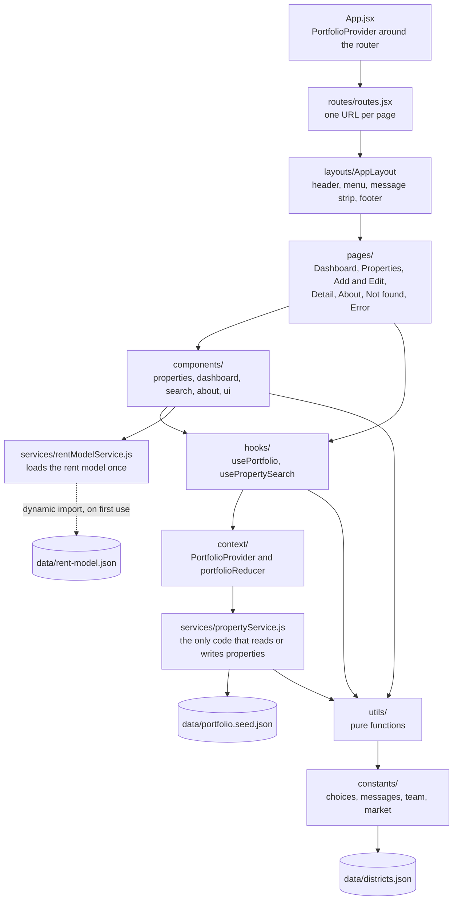

# Architecture

Part of deliverable PD-04 (SRS section 12), with [features.md](features.md) and the
[README](../README.md). It describes the code as it is on 16 October 2026, at commit `af9b312`
on the `ml-model` branch, not the plans in the SRS. Where a planned part is missing, it says so.

## 1. Overview

Darscope is a single-page React app for one company's rental villas and duplexes in Riyadh,
Jeddah, Dammam and Al Khobar. It runs entirely in the browser. The portfolio is an array of
plain objects held in memory, copied from a JSON seed file when the app starts. There is no
server, no database, no cookie, no analytics and no API key, so every change lasts until the page
reloads (FR-DAT-02, IF-01 to IF-03). One AI feature is built: the Add and Edit forms suggest a
yearly rent from the rent model the team trained on 2021 listings. Its weights are a JSON file the
browser loads the first time a form needs them.

## 2. Modules

| Module | What it does |
| --- | --- |
| `App.jsx` | Puts `PortfolioProvider` around a browser router, so every page reads one collection. |
| `routes/` | `routes.jsx` maps each URL to its page inside `AppLayout`, with `ErrorPage` as the error boundary. `paths.js` holds every URL. |
| `layouts/` | The header with the menu, the one message strip that screen readers announce, and the footer. |
| `pages/` | One thin component per URL. Each reads state through a hook and arranges components. |
| `components/` | The building blocks, one folder per feature, with shared pieces in `ui/`: `Button`, `Badge`, `Dialog`, `FormField`, `Message`, `Page`. |
| `hooks/` | `usePortfolio` gives a component the properties and the actions that change them. `usePropertySearch` holds the search box and filters, and works out the matching properties. |
| `context/` | `PortfolioProvider` loads the portfolio, runs the actions and clears each message after 5 seconds. `portfolioReducer` is the pure function that applies each change. |
| `services/propertyService.js` | The data service: the only code that reads or writes properties. Part 2 replaces this one file (section 4). |
| `services/rentModelService.js` | Loads the rent model's weights with a dynamic `import()`, once, and lets a later form try again if the load fails. |
| `utils/` | Pure functions with no React in them: field checks, search, sorting, paging, the URL state, Arabic normalisation, formatting, Dashboard figures, the rent model and team photos. |
| `constants/` | Every fixed list, message and threshold, so no component repeats one (NFR-MNT-04). |

Not built yet: the market reference set and its service (`marketService.js`), the
language-model wrapper (`embeddingService.js`) and the `components/market/` folder. They belong to
the Should features in SRS 7.1 to 7.4.

## 3. Data flow

### Add a property

1. **Add property** in the menu opens `/properties/new`. `PropertyFormPage` renders
   `PropertyForm` with blank values: Type Villa, Status Vacant, no amenities (FR-ADD-09).
2. On **Save**, the form runs `validateProperty` from `utils/validation.js`. If a check fails,
   nothing is saved: each message appears under its field, focus moves to the first invalid field
   and every typed value stays (FR-ADD-03).
3. Otherwise the page calls `addProperty(values)` from `usePortfolio`.
4. `PortfolioProvider` calls `propertyService.create(values)`. The service checks the values
   again, so nothing invalid can enter even without the form (NFR-REL-03). It trims and converts
   them, takes the next ID from a counter that only goes up, sets `createdAt` and `updatedAt`, and
   replaces the array with a new one (NFR-REL-04). It resolves with a copy of the new property.
5. The provider dispatches `property/added`. The reducer appends the property and sets the
   message "Property RP-0009 added".
6. The page navigates to the new property's detail page. The list, the search results and the
   Dashboard read the same state, so they show the property at once (FR-ADD-05, FR-ADD-06).
7. The message clears itself after 5 seconds, or sooner with × (FR-FBK-01).

### Update a property

The same path, through `updateProperty(id, values)` and `propertyService.update`. The service
keeps `id` and `createdAt`, sets a new `updatedAt` (FR-UPD-03), and the reducer swaps in the new
object. If the status leaves Occupied, the form warns first and the service clears the tenant and
lease on save (FR-UPD-07).

### Delete a property

1. **Delete** on a list row or the detail page opens `DeletePropertyDialog`, a native
   `<dialog>` that names the property. Cancel has focus first and Esc cancels (FR-DEL-02).
2. **Delete** in the dialog calls `deleteProperty(id)`, and the service filters the property out
   of a new array. Its ID is never issued again, because the counter does not go down
   (FR-DEL-06).
3. The reducer removes the property and sets "Property RP-0001 deleted". From the detail page the
   app returns to the list (FR-DEL-03 to FR-DEL-05).

### Search and filter

1. Each keystroke in the search box sets `text` in `usePropertySearch`. The search itself uses
   `query`, which follows `text` 300 ms after the last keystroke, or at once on Enter (FR-SRC-03).
2. A filter change sets `filters` at once. `validateFilters` reports a rent or size range whose
   "from" is above its "to", and that range is skipped (FR-SRC-07).
3. `searchProperties` keeps a property when every typed word appears in its searchable text and
   every filter matches (FR-SRC-02, FR-SRC-05). Both sides of each comparison go through
   `normalise` in `utils/arabic.js`, so Arabic spelling variants match (Appendix B.4). The result
   is memoised on the properties, the query and the filters.
4. The list shows the result and "Showing X of Y properties" (FR-LST-04).

### Rent suggestion

1. The first time a form shows `RentSuggestion`, it calls `loadRentModel()`, which imports
   `data/rent-model.json`. The build puts that file in its own 7.90 kB chunk, so the first page
   never waits for it (FR-RNT-02).
2. On every render, `canSuggestRent` checks the fields the model needs, and `suggestedRent`
   computes the rent from the form's values (section 7).
3. **Use this rent** copies the amount into Yearly rent. Nothing else changes the field
   (FR-ADD-13).

## 4. The Part 2 seam

Pages and components never import a data file and never call the data service. Only the actions
in `PortfolioProvider` call `services/propertyService.js`, so Part 2 can replace that one file
with HTTP calls to the hand-written backend, and nothing above it changes. Every operation
already returns a Promise, as a network call would.

| Operation | Input | Resolves with | Rejects with |
| --- | --- | --- | --- |
| `list()` | Nothing | Every property | Never |
| `getById(id)` | A property ID | That property | `NotFoundError` when no property has the ID |
| `create(values)` | The field values, without `id` or timestamps | The new property, with its ID and timestamps | `ValidationError`, whose `errors` holds one message per invalid field |
| `update(id, values)` | An ID and the new field values | The updated property | `NotFoundError`, or `ValidationError` |
| `remove(id)` | A property ID | The removed property | `NotFoundError` |
| `restore(property)` | A property that `remove` returned | The same property, back in its place | An `Error` when the ID is already in use |
| `reset()` | Nothing | The seed properties | Never |

What Part 2 replaces, and what it keeps:

- **Replaced:** the array in memory, the ID counter and the copy of the seed, all inside
  `propertyService.js`. The backend takes over storage, IDs and timestamps.
- **Kept:** the function names, inputs and return shapes above. The form reads
  `ValidationError.errors` to show each message beside its field, so the backend has to send its
  messages keyed by field name, with the wording of SRS Appendix C.
- **Checked twice:** the form keeps calling `utils/validation.js` for instant messages, and the
  backend has to apply the same checks itself, as the service does now (NFR-REL-03).
- Today only the tests call `restore` and `reset`: Undo (FR-DEL-07) and Reset demo data
  (FR-DAT-05) are not built yet.

## 5. Technology stack

Versions are from `frontend/package.json`, and the installed ones from `package-lock.json`.

| Tool | In `package.json` | Installed | Used for |
| --- | --- | --- | --- |
| React and React DOM | ^19.2.8 | 19.3.0 | The interface, written as function components with hooks |
| React Router | ^7.18.4 | 7.18.4 | One URL per page, Back and Forward, links (FR-NAV-03 to FR-NAV-06) |
| React Context with `useReducer` | Part of React | | The portfolio state, with no state library (SRS 11) |
| Vite | ^8.3.0 | 8.3.3 | The development server and the production build into `frontend/dist/` |
| @vitejs/plugin-react | ^6.1.1 | 6.1.2 | JSX and fast refresh in Vite |
| vite-imagetools | ^12.0.1 | 12.0.1 | Crops and shrinks the team photos to 800 px WebP when the app is built |
| CSS Modules and CSS variables | Part of Vite | | One stylesheet per component, with the design tokens in `styles/tokens.css` (UI-06) |
| Vitest | ^5.0.3 | 5.0.3 | The test runner (`npm test`) |
| @vitest/coverage-v8 | ^5.0.3 | 5.0.3 | The coverage summary (`npm run coverage`) |
| jsdom | ^29.1.1 | 29.1.1 | A browser environment for the tests |
| React Testing Library | ^16.3.3 | 16.3.3 | Renders components in tests and finds elements by role and label |
| user-event | ^14.6.7 | 14.6.7 | Types and clicks in tests as a user would |
| jest-dom | ^7.0.1 | 7.0.1 | Matchers such as `toBeInTheDocument` and `toHaveFocus` |
| ESLint | ^10.10.0 | 10.12.0 | Linting, with the React hooks and fast refresh plugins (`npm run lint`) |
| Prettier | ^3.9.9 | 3.9.9 | Formatting (`npm run format`) |
| @types/react, @types/react-dom | ^19.2.18, ^19.2.7 | 19.3.0, 19.3.0 | Editor hints from the JSDoc type comments; the code is JavaScript |
| Node.js | | 22.20.0 on the team's machine | Running the tools. The README asks for 22.13 or later. |

The rent model is trained outside the app, in `ai-model/prepare.ipynb`, with Python and the
libraries in `ai-model/requirements.txt`: pandas 2.3.3, matplotlib 3.10.6 and scikit-learn
1.7.2. The app uses only the JSON files the notebook exports.

## 6. Folder guide

| Folder under `frontend/src/` | Holds |
| --- | --- |
| `assets/team/` | The team photos, at any size. The build crops and shrinks them. |
| `components/about/` | The team gallery and the person card on the About page |
| `components/dashboard/` | The summary cards, the city table and the Needs attention list |
| `components/properties/` | The table, the detail view, the form, the District field, the rent suggestion, the delete dialog and "Property not found" |
| `components/search/` | The search box and the filters |
| `components/ui/` | The shared pieces: `Button`, `Badge`, `Dialog`, `FormField`, `Message`, `Page` and `Placeholder` |
| `constants/` | `options.js` (choices and ranges), `messages.js` (every message), `market.js` (rounding and the mistyped-rent factor), `team.js` (team and course) |
| `context/` | The portfolio context, its provider and its reducer |
| `data/` | The seed portfolio, the rent model's weights and the district list, plus a README on where they come from |
| `hooks/` | `usePortfolio` and `usePropertySearch` |
| `layouts/` | `AppLayout`, `NavMenu` and `Footer` |
| `pages/` | One component per URL |
| `routes/` | The route table and the URL of every page |
| `services/` | `propertyService.js`, the data service, and `rentModelService.js` |
| `styles/` | `tokens.css`, the design tokens, and `global.css`, which styles plain elements only |
| `test/` | The test setup, shared fixtures and a render helper with the router and the portfolio |
| `utils/` | The pure functions, each with its tests beside it |

## 7. AI features

### Rent suggestion (built)

The rent model is the only model the team trains. It is Ridge regression on the logarithm of the
yearly rent, learned in `ai-model/prepare.ipynb` from the 2021 AQAR listings after cleaning. On
304 houses held out from training, its suggestions are off by 23.1% of the rent on average
(22,998 SAR), against 38.8% for a baseline that uses only the city and size
(`ai-model/README.md`). The app calls the result a suggestion from 2021 listings, never a
valuation.

- **What it reads** (FR-RNT-01): city, district, front, type, size, age, the room counts, the 13
  amenities, and whether the description mentions an annex (ملحق) or an internal staircase
  (درج داخلي). `utils/rentModel.js` turns these into the model's inputs the way the notebook does.
  District names are compared after Arabic normalisation (Appendix B.4) and only within their
  city. A district picked from the dropdown by its English name is looked up by the Arabic name
  that `data/districts.json` pairs it with.
- **How it computes:** the logarithm of the rent is a base value, plus one number each for the
  city, the front, the type and the district, plus each numeric input times its weight. The rent
  is the exponential of that sum, rounded to the nearest 500 SAR (`RENT_ROUNDING_SAR` in
  `constants/market.js`).
- **How it loads:** with a dynamic `import()` the first time a form shows the suggestion, never
  with the first page. The weights hold no rows of the dataset. Nothing leaves the browser
  (FR-RNT-02).
- **When it suggests nothing:** a missing or invalid city, size, age or room count, or a size
  outside the 100 to 1,652 m² the model learned from. The panel says which (FR-RNT-03, FR-RNT-04).
- **When it is less sure:** a district the model has not seen gets the average district and a
  note that the suggestion is less precise (FR-RNT-05).
- **When it fails:** if the weights cannot load, the panel says so and the form works as before
  (FR-RNT-06, NFR-REL-02).
- **The mistyped-rent check:** a typed rent more than 3 times the suggestion, or under a third of
  it, gets a warning that does not stop Save (`RENT_CHECK_FACTOR`, FR-RNT-07).

### Planned, not built

- **Search by meaning (SRS 7.1)** will use a ready-made multilingual language model,
  `Xenova/multilingual-e5-small`, run in the browser with Transformers.js after the user agrees to
  the download. The team trains no model for it.
- **Comparable listings and the fair-rent estimate (SRS 7.2, 7.3)** will use a nearest-neighbour
  method with fixed weights over the 2021 market reference set. Nothing is trained.
- **Market insights (SRS 7.4)** will be plain statistics, not AI.
