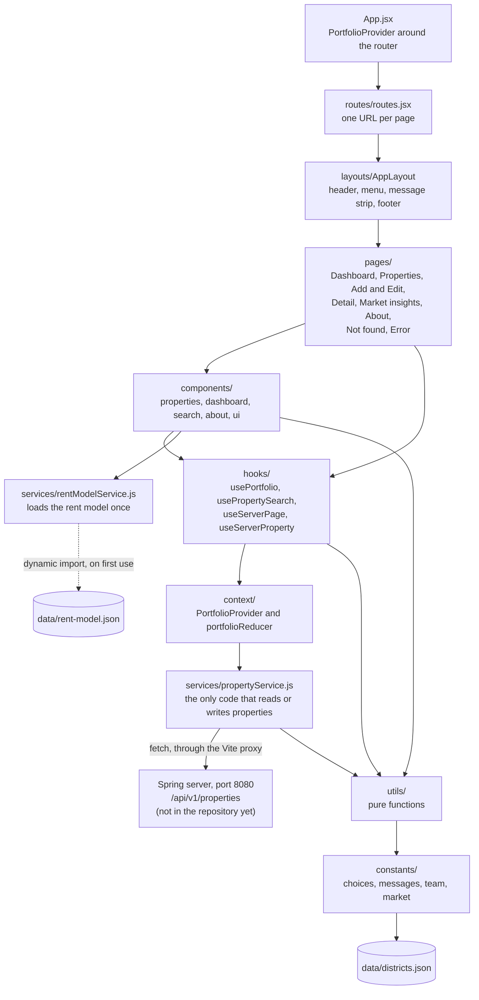

# Architecture

Part of deliverable PD-04 (SRS section 12), with [features.md](features.md) and the
[README](../README.md). It describes the code as it is on 11 November 2026, not the plans in the
SRS. Where a planned part is missing, it says so. Requirement IDs follow SRS version 1.1.

## 1. Overview

Darscope is a single-page React app for one company's rental villas and duplexes in Riyadh,
Jeddah, Dammam and Al Khobar. The interface runs in the browser. Since Part 2 the portfolio
lives in the team's Java Spring server, in Supabase Postgres (or an H2 database in the server's
memory for local runs), and the app reads and writes it through that server's REST API. On
Supabase changes are kept; on H2 they last until the server stops. The browser keeps only what the server returned. It holds no database,
no cookie, no analytics and no API key. One AI feature is built: the Add and Edit forms suggest
a yearly rent from the rent model the team trained on 2021 listings. That runs in the browser
too, from a JSON file of weights loaded the first time a form needs it.

The server is hand-coded by the team (`docs/part-2-brief.md`). Its contract is
`docs/backend-plan.md`. On 11 November 2026 its code is not in the repository yet: there is no
`backend/` folder on `dev` or `main`.

## 2. Modules

| Module | What it does |
| --- | --- |
| `App.jsx` | Puts `PortfolioProvider` around a browser router, so every page reads one collection. |
| `routes/` | `routes.jsx` maps each URL to its page inside `AppLayout`, with `ErrorPage` as the error boundary. `paths.js` holds every URL. |
| `layouts/` | The header with the menu, which folds behind a Menu button below 768 px, the one message strip that screen readers announce, and the footer. |
| `pages/` | One thin component per URL. Each reads state through a hook and arranges components. |
| `components/` | The building blocks, one folder per feature, with shared pieces in `ui/`: `Button` and `ButtonLink`, `Badge`, `Dialog`, `FormField`, `Message`, `Page`, `Pager`, `EmptyState` and `LoadError`. |
| `hooks/` | `usePortfolio` gives a component the properties and the actions that change them. `usePropertySearch` holds the search box, the filters and the page number, and works out the matching properties. `useServerPage` asks the server for one page of the list, and `useServerProperty` for one property by its ID. |
| `context/` | `PortfolioProvider` loads the portfolio from the server once, runs the actions and clears each message after 5 seconds. `portfolioReducer` is the pure function that applies each change. |
| `services/propertyService.js` | The data service: the only code that reads or writes properties. It calls the server's REST routes and translates between the server's JSON and the app's shape (section 4). |
| `services/rentModelService.js` | Loads the rent model's weights with a dynamic `import()`, once, and lets a later form try again if the load fails. |
| `utils/` | Pure functions with no React in them: field checks, search, sorting, paging, the URL state, Arabic normalisation, formatting, Dashboard figures, the rent model and team photos. |
| `constants/` | Every fixed list, message and threshold, so no component repeats one (NFR-MNT-04). |

Not built yet: the market reference set and its service (`marketService.js`), the
language-model wrapper (`embeddingService.js`) and the `components/market/` folder. They belong to
the Should features in SRS 7.1 to 7.4. `/insights` shows a placeholder page and is not in the menu.

## 3. Data flow

### Start

1. `PortfolioProvider` calls `propertyService.list()` once, which asks the server for
   `GET /api/v1/properties?page=0&size=1000`.
2. The reducer stores the properties. The Dashboard, the search and the edit page all read this
   one list. While it loads, each page says "Loading…".
3. If the server cannot be reached, or answers with a 5xx status, the Dashboard, the property list
   and the edit page show "The Darscope server could not be reached. Check that it is running,
   then try again." in place of their content.

One request of up to 1,000 properties is a deliberate limit, marked in the code. A larger
portfolio would need the service to loop over pages.

### Open a property

1. `/properties/RP-0007` renders `PropertyDetailPage`, which calls `useServerProperty('RP-0007')`.
2. The hook calls `loadProperty` from `usePortfolio`, and the provider calls
   `propertyService.getById`, which asks for `GET /api/v1/properties/7` (Part 2 brief,
   requirement 3).
3. A 404 becomes `NotFoundError`, and the page shows "Property not found" (FR-DET-03). A server
   that cannot be reached shows the message from "Start" instead.
4. The hook asks again whenever the portfolio in state changes, and keeps the last answer on
   screen meanwhile.

### Add a property

1. **Add property** in the menu opens `/properties/new`. `PropertyFormPage` renders
   `PropertyForm` with blank values: Type Villa, Status Vacant, no amenities (FR-ADD-09).
2. On **Save**, the form runs `validateProperty` from `utils/validation.js`. If a check fails,
   nothing is sent: each message appears under its field, focus moves to the first invalid field
   and every typed value stays (FR-ADD-03).
3. Otherwise the page calls `addProperty(values)` from `usePortfolio`.
4. `PortfolioProvider` calls `propertyService.create(values)`. The service checks the values
   again, so nothing invalid is sent even without the form (NFR-REL-03). `toServer` trims them,
   turns the `amenities` object into 13 flat fields and empty text into `null`, and the service
   sends `POST /api/v1/properties`.
5. The server checks the values a third time, issues the ID and both timestamps, and answers
   201 with the new property. `fromServer` turns its numeric ID into `RP-0009`, the flat
   amenities back into an object and `null` into empty text.
6. The provider dispatches `property/added`. The reducer appends the property and sets the
   message "Property RP-0009 added".
7. The page navigates to the new property's detail page. The list, the search results and the
   Dashboard read the same state, so they show the property at once (FR-ADD-05, FR-ADD-06).
8. The message clears itself after 5 seconds, or sooner with × (FR-FBK-01).

If the server rejects a field with 400, the service raises a `ValidationError` holding the
server's messages, and the form shows each one under its field as it does its own. If the server
cannot be reached, the form shows the message from section 3, "Start", above Save and keeps
everything typed.

### Update a property

The same path, through `updateProperty(id, values)`, `propertyService.update` and
`PUT /api/v1/properties/{n}`. The server keeps `id` and `createdAt` and sets a new `updatedAt`
(FR-UPD-03), and the reducer swaps in the object it returned. If the status leaves Occupied, the
form warns first and the tenant and lease are cleared on save (FR-UPD-07).

### Delete a property

1. **Delete** on a list row or the detail page opens `DeletePropertyDialog`, a native
   `<dialog>` that names the property. Cancel has focus first and Esc cancels (FR-DEL-02).
2. **Delete** in the dialog calls `deleteProperty(id)`, and the service sends
   `DELETE /api/v1/properties/{n}`. The server answers 204. Its database never issues the number
   again (FR-DEL-06).
3. The reducer removes the property and sets "Property RP-0001 deleted". From the detail page the
   app returns to the list (FR-DEL-03 to FR-DEL-05). If the delete fails, the dialog stays open
   and says why.

### Browse the list a page at a time

1. With nothing typed and no filter set, `useServerPage` asks the server for the page shown:
   `GET /api/v1/properties?page={n-1}&size={5, 10, 25 or 50}`. The server sorts by `updatedAt`,
   newest first.
2. `listPage` turns the answer into `{ items, page, pageCount, from, to, total }`, the same
   shape `paginate` in `utils/sort.js` gives, so `Pager` reads both alike.
3. Whenever the portfolio changes, after an add, an edit or a delete, the hook asks again. If a
   delete left the page past the end, it asks for the last page instead. While a page loads, the
   last one stays on screen.

### Search and filter

1. Each keystroke in the search box sets `text` in `usePropertySearch`. The search itself uses
   `query`, which follows `text` 300 ms after the last keystroke, or at once on Enter (FR-SRC-03).
2. A filter change sets `filters` at once. `validateFilters` reports a rent or size range whose
   "from" is above its "to", and that range is skipped (FR-SRC-07).
3. `searchProperties` keeps a property when every typed word appears in its searchable text and
   every filter matches (FR-SRC-02, FR-SRC-05). Both sides of each comparison go through
   `normalise` in `utils/arabic.js`, so Arabic spelling variants match (Appendix B.4). The result
   is memoised on the properties, the query and the filters.
4. The search runs in the browser on the whole list from "Start", because the Arabic rules live
   there. While a search or filter is active, the page sorts the matches newest first and cuts
   them into pages itself, with `sortProperties` and `paginate`. Any change to the search, the
   filters or the page size goes back to page 1 (FR-LST-10).
5. The list shows the result and "Showing X of Y properties" (FR-LST-04).

### Rent suggestion

1. The first time a form shows `RentSuggestion`, it calls `loadRentModel()`, which imports
   `data/rent-model.json`. The build puts that file in its own 7.90 kB chunk, so the first page
   never waits for it (FR-RNT-02).
2. On every render, `canSuggestRent` checks the fields the model needs, and `suggestedRent`
   computes the rent from the form's values (section 7).
3. **Use this rent** copies the amount into Yearly rent. Nothing else changes the field
   (FR-ADD-13).

## 4. The Part 2 seam

Pages and components never import a data file and never call the data service. Only the actions
in `PortfolioProvider` call `services/propertyService.js`. Part 1 kept the portfolio in memory
inside that file. Part 2 replaced its body with HTTP calls to the Spring server, and no page had
to change. Every operation returns a Promise, before and after.

| Operation | Input | Route | Resolves with | Rejects with |
| --- | --- | --- | --- | --- |
| `list()` | Nothing | `GET /api/v1/properties?page=0&size=1000` | Every property | The server-unavailable error |
| `listPage(page, perPage)` | A page counted from 1, and its size | `GET /api/v1/properties?page={page-1}&size={perPage}` | `{ items, page, pageCount, from, to, total }` | The server-unavailable error |
| `getById(id)` | A property ID such as `RP-0007` | `GET /api/v1/properties/7` | That property | `NotFoundError` |
| `create(values)` | The field values, without `id` or timestamps | `POST /api/v1/properties` | The new property, with its ID and timestamps | `ValidationError`, whose `errors` holds one message per invalid field |
| `update(id, values)` | An ID and the new field values | `PUT /api/v1/properties/7` | The updated property | `NotFoundError`, or `ValidationError` |
| `remove(id)` | A property ID | `DELETE /api/v1/properties/7` | `{ id }` | `NotFoundError` |

How the two sides fit:

- **The proxy.** `npm run dev` forwards every `/api` call from port 5173 to the server on port
  8080 (`frontend/vite.config.js`). The browser sees one address, so the server needs no CORS
  settings.
- **Two shapes.** The server keeps lab 14's shape: a numeric ID, the 13 amenities as flat
  fields, and `null` for an empty field. The app keeps its own: `RP-0007`, an `amenities`
  object, and empty text. `fromServer` and `toServer` translate, and `formatId` and `idNumber`
  convert the ID. An ID that is not `RP-` and digits is rejected as not found without a request.
- **Errors.** A 400 with an `errors` object becomes a `ValidationError`, so the server's messages
  appear beside their fields. A 404 becomes a `NotFoundError`. A network failure or any other
  status becomes one error with the server-unavailable message in `constants/messages.js`.
- **Checked three times.** The form calls `utils/validation.js` for instant messages, the service
  calls it again before sending, and the server applies the same checks with the same messages
  (`docs/backend-plan.md`, section 5, NFR-REL-03).
- **Search by ID.** The detail page calls `getById` through `useServerProperty`, so it always
  shows the server's copy. The edit page reads the property from the list loaded at start, which
  holds a new or changed property at once, because state takes what `create` and `update`
  returned.
- **Removed in Part 2.** `restore` (undo, FR-DEL-07) and `reset` (Reset demo data, FR-DAT-05),
  both withdrawn in SRS version 1.1. Nothing on screen used them, and resetting a shared
  database is risky.
- **Tests never reach the server.** `src/test/setup.js` swaps the module for
  `src/test/fakePropertyService.js`, which keeps the same functions in memory and starts from
  `src/test/portfolio.seed.json`. Only `propertyService.test.js` tests the real module, with
  `fetch` replaced by a stub.

## 5. Technology stack

Versions are from `frontend/package.json`, and the installed ones from `package-lock.json`.

| Tool | In `package.json` | Installed | Used for |
| --- | --- | --- | --- |
| React and React DOM | ^19.2.8 | 19.3.0 | The interface, written as function components with hooks |
| React Router | ^7.18.4 | 7.18.4 | One URL per page, Back and Forward, links (FR-NAV-03 to FR-NAV-06) |
| React Context with `useReducer` | Part of React | | The portfolio state, with no state library (SRS 11) |
| `fetch` | Part of the browser | | The calls to the Spring server, with no HTTP library |
| Vite | ^8.3.0 | 8.3.3 | The development server, its `/api` proxy, and the production build into `frontend/dist/` |
| @vitejs/plugin-react | ^6.1.1 | 6.1.2 | JSX and fast refresh in Vite |
| vite-imagetools | ^12.0.1 | 12.0.1 | Crops and shrinks the team photos to 800 px WebP when the app is built |
| CSS Modules and CSS variables | Part of Vite | | One stylesheet per component, with the design tokens in `styles/tokens.css` (UI-06) |
| Vitest | ^5.0.3 | 5.0.3 | The test runner (`npm test`) |
| @vitest/coverage-v8 | ^5.0.3 | 5.0.3 | The coverage summary (`npm run coverage`) |
| jsdom | ^29.1.1 | 29.1.1 | A browser environment for the tests |
| React Testing Library | ^16.3.3 | 16.3.3 | Renders components in tests and finds elements by role and label |
| user-event | ^14.6.7 | 14.6.7 | Types and clicks in tests as a user would |
| jest-dom | ^7.0.1 | 7.0.1 | Matchers such as `toBeInTheDocument` and `toHaveFocus` |
| ESLint | ^10.10.0 | 10.12.0 | Linting, with the React hooks and fast refresh plugins (`npm run lint`) |
| Prettier | ^3.9.9 | 3.9.9 | Formatting (`npm run format`) |
| @types/react, @types/react-dom | ^19.2.18, ^19.2.7 | 19.3.0, 19.3.0 | Editor hints from the JSDoc type comments; the code is JavaScript |
| Node.js | | 22.20.0 on the team's machine | Running the tools. The README asks for 22.13 or later. |

The server's stack was chosen on 9 November 2026 (`docs/backend-plan.md`, section 6): Maven,
Java 21, Spring Boot 4.1, Spring Web, Spring Data JDBC, Bean Validation, Supabase Postgres
through the PostgreSQL driver, an in-memory H2 database for local runs and the tests, and JUnit
with Mockito. Supabase was dropped on 11 November 2026 and brought back on 12 November 2026. Its code is not in the
repository yet, so this document gives no installed versions for it.

The rent model is trained outside the app, in `ai-model/prepare.ipynb`, with Python and the
libraries in `ai-model/requirements.txt`: pandas 2.3.3, matplotlib 3.10.6 and scikit-learn
1.7.2. The app uses only the JSON files the notebook exports.

## 6. Folder guide

| Folder under `frontend/src/` | Holds |
| --- | --- |
| `assets/team/` | The team photos, at any size. The build crops and shrinks them. |
| `components/about/` | The team gallery and the person card on the About page |
| `components/dashboard/` | The summary cards, the city table and the Needs attention list |
| `components/properties/` | The table, the detail view, the form, the District field, the rent suggestion, the delete dialog and "Property not found" |
| `components/search/` | The search box and the filters |
| `components/ui/` | The shared pieces: `Button` and `ButtonLink`, `Badge`, `Dialog`, `FormField`, `Message`, `Page`, `Pager`, `EmptyState` and `LoadError` (`PageStates.jsx`), and `Placeholder` |
| `constants/` | `options.js` (choices and ranges), `messages.js` (every message), `market.js` (rounding and the mistyped-rent factor), `team.js` (team and course) |
| `context/` | The portfolio context, its provider and its reducer |
| `data/` | The rent model's weights and the district list, plus a README on where they come from |
| `hooks/` | `usePortfolio`, `usePropertySearch`, `useServerPage` and `useServerProperty` |
| `layouts/` | `AppLayout`, `NavMenu` and `Footer` |
| `pages/` | One component per URL |
| `routes/` | The route table and the URL of every page |
| `services/` | `propertyService.js`, the data service that calls the server, and `rentModelService.js` |
| `styles/` | `tokens.css`, the design tokens, and `global.css`, which styles plain elements only |
| `test/` | The test setup, shared fixtures, a render helper with the router and the portfolio, and the in-memory stand-in for the server with its 8-property seed. `__setServerDown` makes the stand-in fail as a stopped server would. |
| `utils/` | The pure functions, each with its tests beside it |

## 7. AI features

### Rent suggestion (built)

The rent model is the only model the team trains. It is Ridge regression on the logarithm of the
yearly rent, learned in `ai-model/prepare.ipynb` from the 2021 AQAR listings after cleaning. On
304 houses held out from training, its suggestions are off by 23.1% of the rent on average
(22,998 SAR), against 38.8% for a baseline that uses only the city and size
(`ai-model/README.md`). The app calls the result a suggestion from 2021 listings, never a
valuation.

- **What it reads** (FR-RNT-01): city, district, front, type, size, age, the room counts, the 13
  amenities, and whether the description mentions an annex (ملحق) or an internal staircase
  (درج داخلي). `utils/rentModel.js` turns these into the model's inputs the way the notebook does.
  District names are compared after Arabic normalisation (Appendix B.4) and only within their
  city. A district picked from the dropdown by its English name is looked up by the Arabic name
  that `data/districts.json` pairs it with.
- **How it computes:** the logarithm of the rent is a base value, plus one number each for the
  city, the front, the type and the district, plus each numeric input times its weight. The rent
  is the exponential of that sum, rounded to the nearest 500 SAR (`RENT_ROUNDING_SAR` in
  `constants/market.js`).
- **How it loads:** with a dynamic `import()` the first time a form shows the suggestion, never
  with the first page. The weights hold no rows of the dataset. The suggestion is computed in the
  browser, and nothing about it is sent to the server (FR-RNT-02).
- **When it suggests nothing:** a missing or invalid city, size, age or room count, or a size
  outside the 100 to 1,652 m² the model learned from. The panel says which (FR-RNT-03, FR-RNT-04).
- **When it is less sure:** a district the model has not seen gets the average district and a
  note that the suggestion is less precise (FR-RNT-05).
- **When it fails:** if the weights cannot load, the panel says so and the form works as before
  (FR-RNT-06, NFR-REL-02).
- **The mistyped-rent check:** a typed rent more than 3 times the suggestion, or under a third of
  it, gets a warning that does not stop Save (`RENT_CHECK_FACTOR`, FR-RNT-07).

### Planned, not built

- **Search by meaning (SRS 7.1)** will use a ready-made multilingual language model,
  `Xenova/multilingual-e5-small`, run in the browser with Transformers.js after the user agrees to
  the download. The team trains no model for it.
- **Comparable listings and the fair-rent estimate (SRS 7.2, 7.3)** will use a nearest-neighbour
  method with fixed weights over the 2021 market reference set. Nothing is trained.
- **Market insights (SRS 7.4)** will be plain statistics, not AI.
